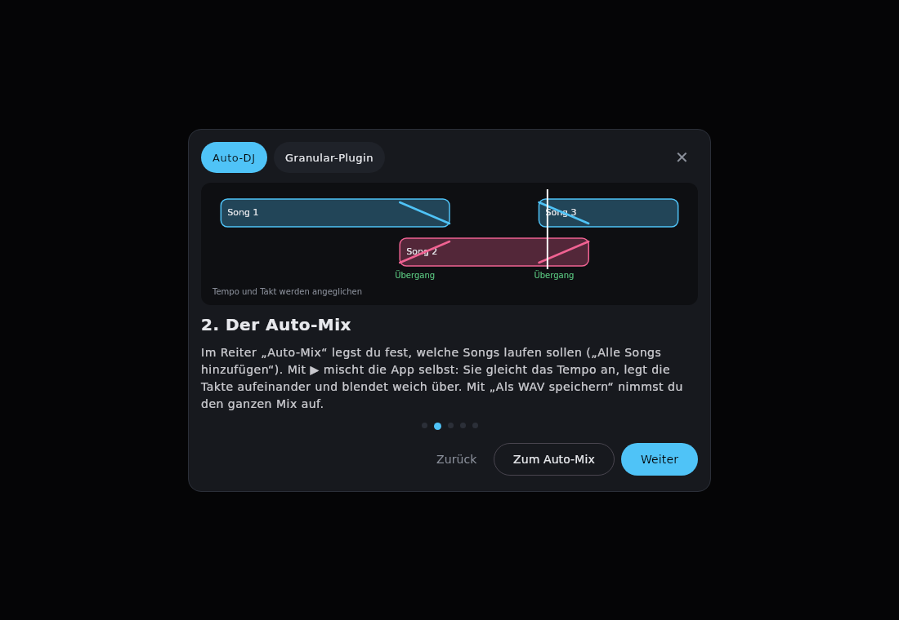
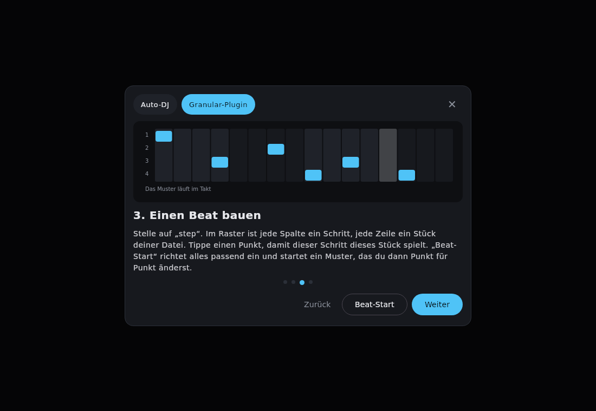
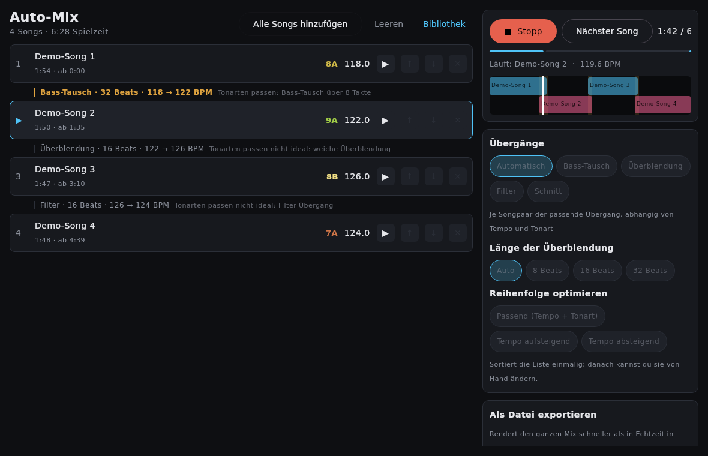
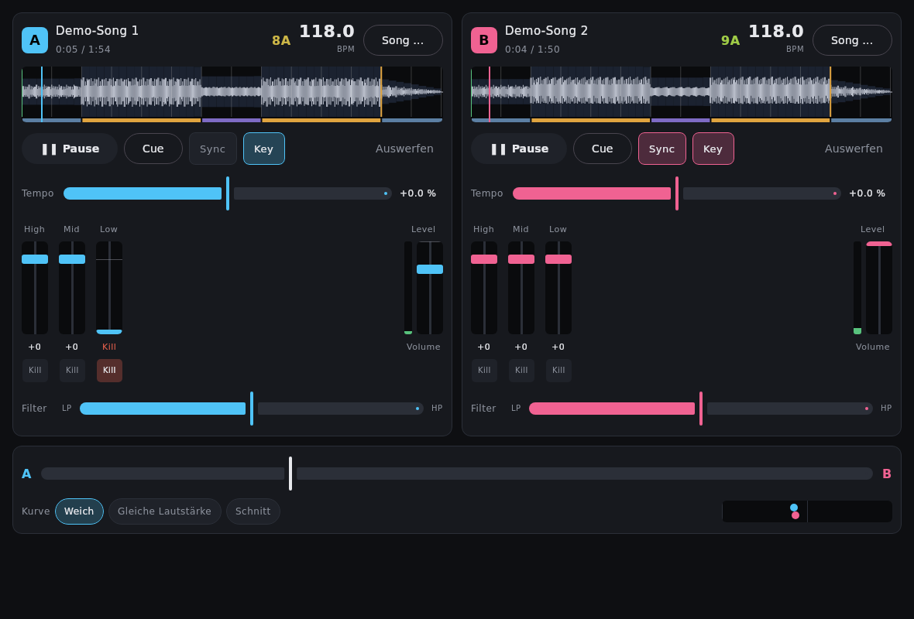
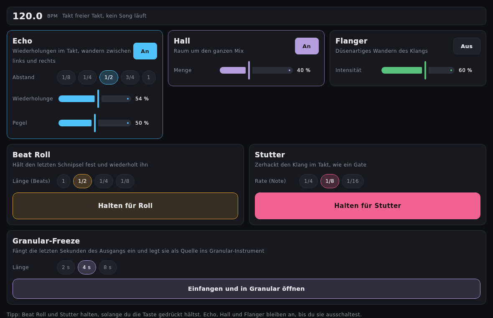
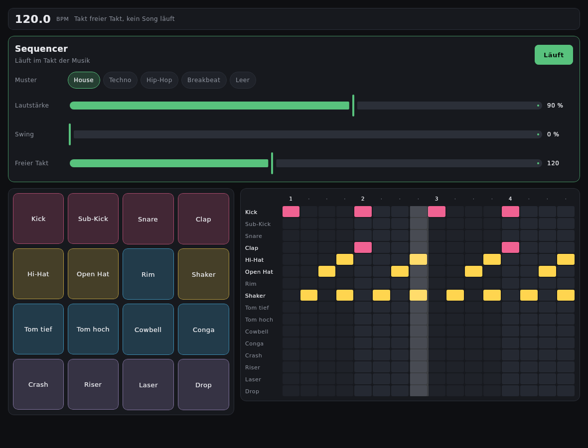
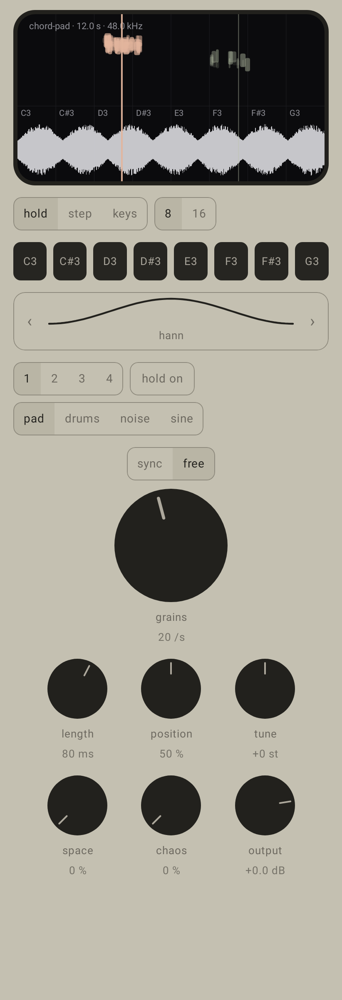
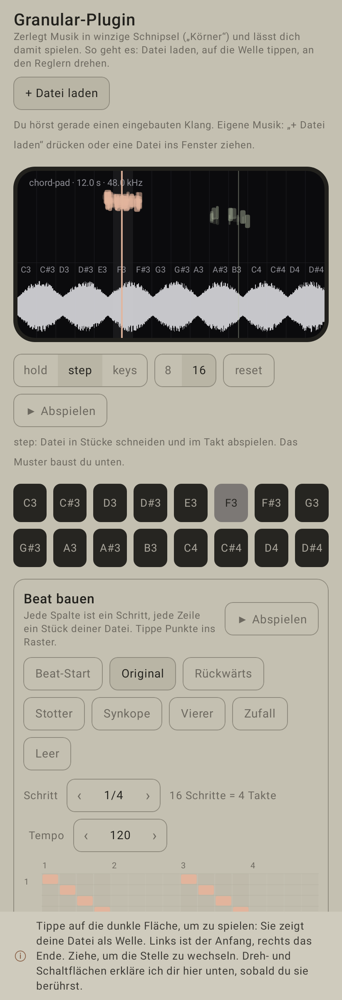
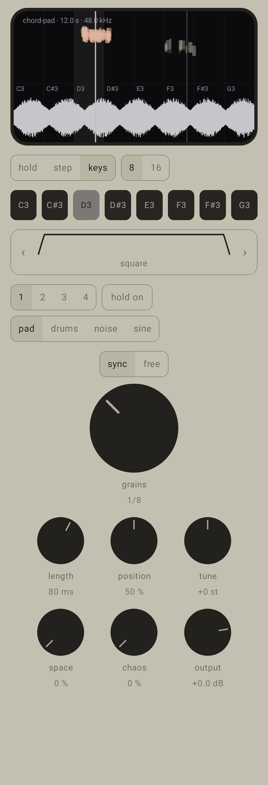

# AutoDJ

Auto-DJ für **Android und macOS**: Songs in eine Liste legen, automatisch ineinander mischen lassen (oder von Hand auf zwei Decks),
mit Effekten und Drum-Pads selbst mitspielen, und eine **Granular-Engine** als Instrument. Kotlin + Compose für die Oberfläche,
C++17 für den gesamten Audiokern, Oboe/AAudio (Android) bzw. CoreAudio (macOS) für die Ausgabe.

## So benutzt du es

Oben (Mac) bzw. unten (Android, dort zusätzlich ein Tab „Entwickler“ mit Parametern und Debug) sind sechs Tabs:

| Tab | Was du dort tust |
|---|---|
| **Bibliothek** | Songs hinzufügen (MP3, WAV, FLAC, OGG, M4A …) oder die vier Demo-Songs laden. Jeder Song wird analysiert (Tempo, Takt-Raster, Tonart, Energie, Aufbau). Pro Song: *A* / *B* (auf ein Deck laden), *In die Mix-Liste*, *Granular*. |
| **Auto-Mix** | Songs in die Liste legen (*Alle Songs hinzufügen*), Reihenfolge ändern oder *Reihenfolge optimieren* (passende Tempi und Tonarten nebeneinander), Übergang (Bass-Swap, Crossfade, Filter, Schnitt oder automatisch) und Länge (8/16/32 Beats) wählen, **Mix starten** — die App mischt die Songs im Takt ineinander und lädt sie erst kurz vor ihrem Einsatz. **WAV exportieren …** rendert denselben Mix schneller als Echtzeit in eine Datei (16 oder 24 Bit) plus Tracklist (`.txt`). |
| **Decks** | Zwei Decks von Hand: Wellenform (Tippen springt), Play/Cue, **Sync** (zieht Tempo und Beat-Phase auf das andere Deck), Key-Lock, Tempo ±16 %, EQ mit **Kill**, Filter, Lautstärke, Crossfader mit drei Kurven. |
| **Effekte** | Echo, Hall, Flanger an/aus; **Beat Roll** und **Stutter** gehalten; Echo-Abstand, Roll-Länge und Stutter-Rate im Takt der Musik; **Granular-Freeze** fängt die letzten 2–8 Sekunden des Ausgangs ein und legt sie als Quelle in den Granular-Tab. Die Effekte wirken auf alles, was du hörst. |
| **Pads** | 16 Drum-Pads (Kick, Snare, Hats, Percussion, Crash, Riser …, synthetisch erzeugt) und ein 16-Step-Sequencer mit Mustern (House, Techno, Hip-Hop, Breakbeat, leer), Swing und Lautstärke. Der Sequencer läuft im Takt des Auto-Mixes bzw. des laufenden Decks, sonst mit eigenem Tempo. |
| **Granular** | Das Granular-Instrument (siehe unten); seine Quellen sind die Demo-Klänge, Songs aus der Bibliothek und eingefangene Mix-Ausschnitte. |

**Anleitung in der App:** Beim ersten Start öffnet sich eine Schritt-für-Schritt-Anleitung mit kleinen Animationen (zwei Kapitel: *Auto-DJ* und *Granular-Plugin*).
Du findest sie jederzeit über **„? Anleitung“** (oben rechts; im Plugin im Kopf) und über die Hinweise oben in jedem Tab. Jeder Schritt hat einen
„Jetzt ausprobieren“-Knopf (Demo-Songs laden, zum Tab springen, Datei wählen, Beat-Start).

| Anleitung: Auto-Mix | Anleitung: Beat im Plugin |
|---|---|
|  |  |

| Auto-Mix (läuft) | Decks | Effekte | Pads + Sequencer |
|---|---|---|---|
|  |  |  |  |

Nichts davon wurde auf einem Mac oder Telefon gehört; geprüft ist es mit Host-Tests, JVM-Tests gegen die echte native Bibliothek (synthetische
Songs, gerenderte Audioausgabe) und der CI.

## Stand

| Meilenstein | Inhalt | Status |
|---|---|---|
| 1 | Setup, Oboe-Ausgabe, Audio-Thread-Regeln, lock-freie Queues, Parameter-Registry, Transport/BPM-Clock | **fertig** (Host-getestet) |
| 2 | Granular-Prototyp mit Benchmarks 64/128/256/512 Grains, Stresstest | **fertig** (Host-getestet) |
| 2+ | Instrument-Oberfläche nach der genannten Referenz (Cells Hold/Step/Keys, Chaos, Output, dunkler Bildschirm) | **fertig** (Host- und JVM-getestet, nicht auf Gerät) |
| 2++ | macOS-App: dieselbe Instrument-Oberfläche (Compose Multiplatform) auf derselben Engine, CoreAudio-Ausgabe, `.dmg` aus der CI | **gebaut und getestet in der CI, nie auf einem Mac gestartet** |
| 3 | Bibliothek: mehrere Songs importieren (MP3, WAV, FLAC, OGG, M4A), Analyse von BPM, Beat-Raster, Tonart, Energie, Aufbau, Wellenform | **fertig** (Host-, JVM- und CI-getestet mit synthetischen Songs und Testdateien, nicht mit echter Musik) |
| 4 | Decks mit Time-Stretch, Sync, EQ/Filter, Crossfader | **fertig** (Host- und JVM-getestet mit synthetischen Songs) |
| 5 | Auto-Mix: Planer, Übergangstypen, Tempo-Rampen, Ausspielen mit Nachladen, WAV-Export | **fertig** (Host- und JVM-getestet) |
| 6 | Effekte (Echo, Hall, Flanger, Beat Roll, Stutter) | **fertig** (Host- und JVM-getestet); Timeline-Editor und Automation noch offen |
| 7 | Drum-Pads mit Sequencer, Granular-Freeze als Effekt | **fertig** (Host- und JVM-getestet); Sample-Pads und Auto-Slicing noch offen |
| 8–9 | Granular: Modulations-Matrix, XY-Pad; Politur | offen, siehe [Roadmap](docs/ARCHITECTURE.md#8-roadmap-meilensteine-aus-der-spezifikation) |

**Ehrlich gesagt:** Die App wurde gebaut (Debug und Release, arm64-v8a + x86_64) und ihre JVM-Unit-Tests laufen, sie wurde
aber **noch nie auf einem Gerät gestartet**. Alle Messwerte in diesem Repository sind **Host-Werte** (x86_64-Xeon, SSE2,
geteilte VM) und keine Gerätewerte. Der NEON-Pfad wurde auf Korrektheit unter QEMU geprüft, nicht auf Geschwindigkeit. Die Zielwerte aus der
Spezifikation (≥ 256 Grains unter 15 % CPU auf Snapdragon 7, Latenz < 20 ms, Touch-zu-Ton < 30 ms) sind **noch nicht nachgewiesen**;
der Benchmark im Debug-Tab der App liefert die Zahlen auf dem Gerät.

## Schnellstart auf dem Rechner (kein Android nötig)

Voraussetzungen: CMake ≥ 3.22, Ninja, ein C++17-Compiler (GCC 13 oder Apple clang), Python 3. GoogleTest und nlohmann/json
werden beim Konfigurieren geladen (gepinnte Tags).

```bash
cmake -S . -B build-host -G Ninja -DCMAKE_BUILD_TYPE=Release -DAUTODJ_WERROR=ON
ninja -C build-host
ctest --test-dir build-host --output-on-failure        # test_core, test_granular, test_engine, rt_lint (+ Selbsttest)
```

Weitere Konfigurationen, die geprüft wurden: `-DCMAKE_BUILD_TYPE=Debug`, `-DAUTODJ_SANITIZE=address,undefined`,
`-DAUTODJ_SANITIZE=thread`. Mit `-DAUTODJ_RT_GUARD=OFF` entfällt der Allokations-Wächter (für saubere Benchmarks).

```bash
# Benchmark 64/128/256/512 Grains × Callback 128/192 × linear/Hermite × SIMD/skalar  -> Markdown + JSON
build-host/native/bench/bench_granular --md docs/results/bench_host.md --json docs/results/bench_host.json
build-host/native/bench/bench_granular --quick --grains 256 --callbacks 192      # Schnelllauf

# Stresstest: 300 deterministische Fuzz-Seeds, 10 min Audio im Freilauf, 10 min Echtzeit mit Steuer-Thread
build-host/native/tools/stress_test --audio-seconds 600 --paced-seconds 600

# Offline-Render derselben Engine nach WAV (Szenen: pad, shimmer, drums, texture, mix, steps, keys)
build-host/native/tools/render_cli --scene mix --seconds 24 --out mix.wav
```

Hörproben aus diesem Stand liegen als `granular_*.wav` und `instrument_*.wav` (Step- und Keys-Modus) in den Ergebnissen des Threads (nicht im Repository eingecheckt).

## macOS

Die macOS-App liegt in `desktopApp/`: dieselbe Instrument-Oberfläche wie auf Android (Compose Multiplatform teilt die
`androidx.compose`-API; die Dateien werden per `syncSharedSources` aus `app/` übernommen, nicht kopiert), dieselbe
C++-Engine über denselben JNI-Code, aber mit **CoreAudio** statt Oboe (`native/platform/coreaudio/`). Die native Bibliothek
`libautodj_native.dylib` wird universal (arm64 + x86_64) gebaut und in die App gepackt.

**Fertige App herunterladen:** GitHub → *Actions* → neuester Lauf von „CI“ → Artefakt **AutoDJ-macOS** (`.dmg` und `AutoDJ-macos-app.zip`).
Die App ist **nicht signiert und nicht notarisiert**; beim ersten Start blockt macOS sie. Rechtsklick auf die App → *Öffnen*,
oder `xattr -dr com.apple.quarantine /Applications/AutoDJ.app`.

**Selbst bauen** (macOS, Xcode Command Line Tools, CMake, JDK 17 oder neuer):

```bash
./gradlew -PdesktopOnly=true :desktopApp:run                  # startet die App (baut vorher die .dylib)
./gradlew -PdesktopOnly=true :desktopApp:packageDmg           # .dmg unter desktopApp/build/compose/binaries/main/dmg/
./gradlew -PdesktopOnly=true :desktopApp:test                 # JNI-Smoketest gegen die echte .dylib + Offscreen-Render der Oberfläche
```

`-PdesktopOnly=true` lässt das Android-Modul weg (kein Android SDK nötig). Bedienung wie auf Android; Berührung wird zu Mausklick/-ziehen.
Der CI-Lauf baut außerdem den C++-Kern mit Apple clang und führt dort alle Tests aus.

**Ehrlich dazu:** Ich hatte beim Schreiben keinen Mac. Der CoreAudio-Treiber, die `.dylib` und die App sind deshalb nur das, was die CI auf
einem macOS-Runner baut und testet (bei den Audiotests ohne echtes Gerät). Ob Ton herauskommt, wie die Latenz ist und ob die App auf einem
Intel-Mac läuft (der x86_64-Teil wird gebaut, aber nicht ausgeführt), ist **nicht geprüft**.

## Android

Voraussetzungen: Android SDK (Plattform 36), NDK `29.0.14206865`, CMake `3.22.1` (SDK-Manager), JDK 17+.
Gradle 8.14.3 kommt über den Wrapper. `local.properties` mit `sdk.dir=…` anlegen oder `ANDROID_HOME` setzen.

```bash
./gradlew assembleDebug testDebugUnitTest      # Debug-APK (mit RT-Wächter: zählt Verstöße, stürzt nicht ab) + JVM-Tests
./gradlew assembleRelease
```

Oboe 1.10.0 kommt als Prefab-Paket von Google Maven. Die App hat unten die Tabs der Tabelle oben plus **Entwickler** (dort: **Params** mit allen Parametern, generisch aus der Registry erzeugt, Trigger-Pad, Korn-Wolke, **Transport** mit Play/Stop/Rewind, BPM, Master,
Testton, Presets kopieren/einfügen, und **Debug** mit Last, Deadline-Misses, XRuns, aktive Grains, Qualitätsstufe, Latenz,
Kernel-Backend, exklusiver Modus, Benchmark „Quick/Full“ mit „Copy results“).

### Das Instrument (Tab „Granular“)

Aufbau und Funktionen folgen dem Granular-Instrument, das du als Referenz genannt hast (Details und Abgrenzung in
[ARCHITECTURE.md §5a](docs/ARCHITECTURE.md#5a-instrument-oberfläche-nach-referenz)): dunkler Bildschirm mit Korn-Wolke, Wellenform und
Zellraster (Berührung = Spielen), Modi **hold / step / keys**, 8 oder 16 **Cells** mit Pads, Hüllkurven-Auswahl (6 Formen) und
neun Regler: *space, chaos | length, grains, position | tune, output*. Der große *grains*-Regler steuert die Dichte, im
Sync-Modus die Taktteilung. Name, Farben und Zeichencode sind eigen, es sind keine Marken-Assets übernommen.

**Eigene Dateien und Beats im Plugin.** Mit **„+ Datei laden“** (am Mac auch per Drag & Drop ins Fenster) legst du einen Song oder ein Geräusch direkt als Quelle in die gewählte Stimme;
der Fortschritt steht im Kopf, Fehler erscheinen auf Deutsch. Im Modus **step** zeigt das Panel **„Beat bauen“** ein Raster aus 16 Schritten mal Zellen (Stücke) der Datei:
Punkt antippen = dieser Schritt spielt dieses Stück, noch einmal = Pause. Vorlagen (Original, Rückwärts, Stotter, Synkope, Vierer, Zufall, Leer) geben einen Start,
**Beat-Start** richtet alles ein (Drums als Quelle, 16 Zellen, Korn genau im Takt, weiche Hüllkurve) und spielt sofort. Das Raster läuft im Takt der Musik, sobald ein Deck oder der Auto-Mix spielt.
Die Zeile unten im Plugin erklärt jeden Regler, den du anfasst (oder über den du mit der Maus fährst).

**Klang.** Die eingebauten Quellen (pad, drums, pluck, bass) sind neu geschrieben (bandbegrenzte Wellenformen, nahtlose Schleifen, ≈ −15 dB RMS), die Pads sind leiser voreingestellt,
und Song-Analyse pegelt auf dasselbe Niveau. `audio_audit` (native/tools) rendert 16 Szenen offline und misst Spitze, RMS, Knackser, Gleichanteil und Spektrum:
keine Knackser, kein Clipping (Spitzen ≤ 0,89), Gleichanteil ≈ 0; Aliasing wurde in den Spektren nicht gefunden. **Bekannt offen:** Die Decks laufen immer durch den Time-Stretcher, auch bei Tempo 100 %;
ein Bypass bei Originaltempo (etwas sauberer) fehlt noch. Gehört wurde nichts auf echter Hardware.

| hold | step (16 Cells) | keys + sync |
|---|---|---|
|  |  |  |

Die Screenshots entstehen auf der JVM (`./gradlew testDebugUnitTest`, Robolectric + Compose, Ausgabe in `app/build/screenshots`) mit einem
Fake-Host und synthetischen Daten. Sie zeigen das Layout, nicht Schrift oder Rendering eines bestimmten Geräts.

Tests der Oberfläche (19 der 23 JVM-Tests; die übrigen 4 prüfen `ParamSpec`): reine Hilfsfunktionen (Knob-Quantisierung, Hüllkurvenformel = native Formel, Tastennamen), Abgleich der
Instrument-Keys und Bereiche gegen den Registry-Snapshot, und Bedienung über den Accessibility-Baum (Modus-Segmente, Step-Reset,
Pads, Knob per „Fortschritt setzen“ und Doppeltippen, Berührung des Bildschirms, Grains-Regler frei/sync, Hüllkurven-Pfeile).
In Robolectric ruft `captureToImage` den Main-Looper auf, auf dem der Test selbst läuft; die Screenshots zeichnen deshalb das Decor-View direkt in eine Bitmap.

**Erster Gerätelauf (bitte machen):** App starten → Debug-Tab → „Full (~10 min)“ → „Copy results“. Das ergibt die echten
Zahlen für `docs/BENCHMARKS.md`; zusätzlich sollte „RT guard … violations“ im Debug-Build `0` bleiben.

## Verzeichnisse

```
native/core      lock-freie Queues, Parameter-Registry, Presets, Transport, SampleBuffer, RT-Wächter
native/granular  Grain-Pool, Hüllkurven, Kernels (NEON/SSE2/skalar), Scheduler, adaptive Qualität, GranularNode (Cells, Chaos, Output)
native/fx        ChaosFx (Hall → Flanger in einem Regler)
native/analysis  Tempo, Takt-Raster, Tonart, Energie, Aufbau, Wellenform
native/dj        Decks (Time-Stretch), EQ/Filter, Crossfader, Mix-Planer, Plan-Player
native/perf      Master-Effekte (Echo, Beat Roll, Stutter, Hall, Flanger), Drum-Pads mit Sequencer
native/engine    Engine (Commands, Blöcke, Master, Status), Track-Verwaltung, Offline-Export, Testton-Node
native/platform  Audiotreiber + JNI-Brücke: Oboe (Android), CoreAudio (macOS)
native/bench     Benchmark (Host-CLI und App teilen sich den Code)
native/tools     render_cli, stress_test
native/tests     GoogleTest-Suiten + Golden-Datei
app/             Kotlin/Compose (Android)
desktopApp/      macOS-App (Compose Multiplatform), teilt Oberfläche und Engine-Wrapper mit app/
tools/           rt_lint.py (statischer Audio-Thread-Lint)
docs/            ARCHITECTURE.md, AUDIO_THREAD_RULES.md, BENCHMARKS.md, results/, screenshots/
```

## Dokumentation

* [Architekturplan, Entscheidungen, Roadmap](docs/ARCHITECTURE.md)
* [Audio-Thread-Regeln und wie sie durchgesetzt werden](docs/AUDIO_THREAD_RULES.md)
* [Benchmarks und Stresstest: Methode, Zahlen, Grenzen](docs/BENCHMARKS.md)

## Lizenzen der Abhängigkeiten

nlohmann/json (MIT), GoogleTest (BSD-3), Oboe (Apache-2.0), Signalsmith Stretch und Signalsmith Linear (MIT, im Repository unter `third_party/signalsmith`) für das Time-Stretching der Decks.
Der Projektcode steht unter der Apache License 2.0 (siehe [LICENSE](LICENSE)).
